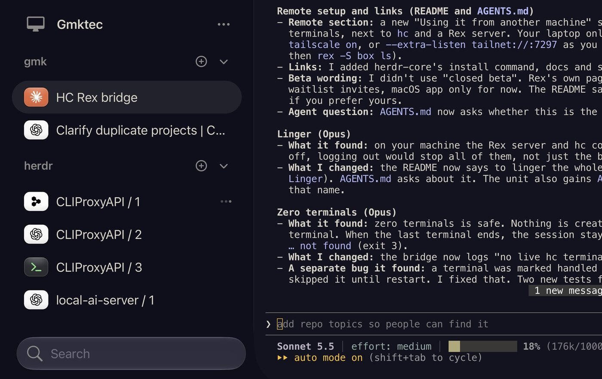

# herdrex-bridge

Show your [hc](https://herdr.dev/core/) (herdr-core) terminals inside [Rex](https://superlogical.com).
Every live hc terminal becomes a Rex window you can watch and type into, so the agents the Herdr app
shows are reachable from any Rex client. (Installs as `hc-rex-bridge`.)



*The Rex app connected to a host. The `herdr` session is the bridge's work: one window per hc
terminal, titled like the Herdr app's tabs (`CLIProxyAPI / 1`, `local-ai-server / 1`).*

## Set it up with a coding agent

On the machine that runs your hc terminals, give your coding agent (Claude Code, Codex, Amp…) this:

```text
Set up https://github.com/yjsoon/herdrex-bridge on this machine. Follow its AGENTS.md.
```

It checks what you have, asks you a few questions, shows a dry run, then installs and verifies.

> **Agents:** clone this repo and follow [AGENTS.md](AGENTS.md) before changing anything.
> [DETAILS.md](DETAILS.md) is the full reference.

## Set it up yourself

You need Python 3.8+, with [hc](https://herdr.dev/core/) and Rex on your `PATH`. Rex is in a
waitlist beta (November 2026); see [DETAILS.md](DETAILS.md#requirements).

```sh
git clone https://github.com/yjsoon/herdrex-bridge && cd herdrex-bridge
./hc_rex_bridge.py --dry-run   # print what it would do, then exit
./hc_rex_bridge.py             # keep syncing until Ctrl-C
```

Then open the `herdr` session in Rex. It appears with the first live hc terminal.

## Run it as a service (Linux, systemd)

```sh
install -Dm755 hc_rex_bridge.py ~/.local/bin/hc-rex-bridge
install -Dm644 hc-rex-bridge.service ~/.config/systemd/user/hc-rex-bridge.service
systemctl --user daemon-reload
systemctl --user enable --now hc-rex-bridge
```

To use it from another machine, run the bridge on the machine that hosts the hc terminals and
connect your Rex client to that host. See [DETAILS.md](DETAILS.md#using-it-from-another-machine).

## Options

| Option | Effect |
| --- | --- |
| `--session NAME` | Rex session that holds the windows. Default `herdr`, or `$HERDREX_SESSION`. |
| `--observe` | Watch only: keystrokes and resizes are not sent. |
| `--once` | Sync one time and exit. |
| `--dry-run` | Print what would change without touching Rex, then exit. |

## Good to know

- Closing a Rex window only detaches. The program keeps running in hc; end it with `hc kill <address>`.
- If the Herdr app is attached too, the two can fight over window size. `--observe` avoids that.

## More

[DETAILS.md](DETAILS.md) covers how it works, requirements, service and remote setup, changing
options, state, and development.

MIT licensed. See [LICENSE](LICENSE).
